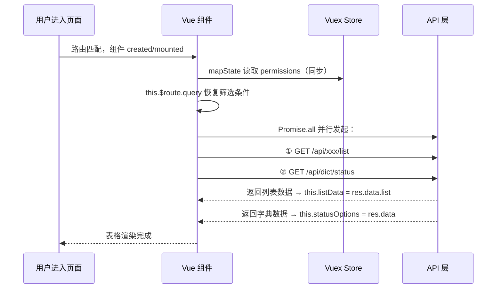

# PRD 页面文档模板（tpl-prd — Vue 版）

> 👤 负责角色：**view-agent**（页面分析师）
> 📋 职责：分析页面.vue 文件，还原页面功能、布局、数据流、交互逻辑和接口调用关系
>
> ⚠️ 生成原则：本模板的目标是"照着文档能从零还原这个页面，功能完全一致"。
> 每一节都必须如实填写，不允许使用"xxx"或"待补充"占位。
> 分析 .vue 文件时，所有细节（v-if 条件、字段名、接口路径、提示文案）都要提取出来写进文档。

```markdown
# [页面中文名称] 页面文档

> **路由路径：** `/xxx`
> **视图文件：** `src/views/XxxView.vue`
> **需要登录：** 是 / 否
> **所需权限：** `permission:xxx:view`（无权限跳转 /403）
> **生成时间：** 2026-03-05 09:16:18

---

## 一、页面概述

**页面定位：** 一句话说清楚这个页面在系统中负责什么业务。

**入口来源：** 用户通过哪些路径进入本页面（侧边栏菜单 / 从哪个页面跳转 / 直接访问）。

**离开去向：**

| 触发操作 | 跳转目标 | 携带参数 |
|---------|---------|---------|
| 点击列表行名称 | `/detail/:id` | id |
| 点击"返回" | `/list` | 无 |

---

## 二、页面布局结构

```
┌─────────────────────────────────────────────────┐
│  页面标题：xxx管理          [新增按钮] [导出按钮]  │
├─────────────────────────────────────────────────┤
│  搜索区                                          │
│  [关键词输入框]  [状态下拉]  [时间范围]  [查询] [重置] │
├─────────────────────────────────────────────────┤
│  已选 N 条  [批量删除]                            │
├─────────────────────────────────────────────────┤
│  数据表格                                        │
│  ☐ | 序号 | 名称 | 状态 | 创建时间 | 操作        │
│  ☐ |  1  | ... | ... |   ...   | 编辑 删除      │
├─────────────────────────────────────────────────┤
│  分页：共 N 条  每页 20 条  [< 1 2 3 >]          │
└─────────────────────────────────────────────────┘
```

**弹窗/抽屉布局（如有）：**
```
┌──────────────────────────────┐
│ 新增xxx               [×关闭] │
├──────────────────────────────┤
│ 名称：[____________] *必填    │
│ 状态：[下拉选择____]  *必填   │
│ 备注：[__________________]   │
├──────────────────────────────┤
│              [取消]  [确认]   │
└──────────────────────────────┘
```

---

## 三、页面数据来源总览

| 数据名称 | 来源类型 | 接口 / 位置 | 加载时机 | 用途 |
|---------|---------|-----------|---------|------|
| 列表数据 | 后端接口 | `GET /api/xxx/list` | 首屏、条件变化、操作后刷新 | 主表格渲染 |
| 状态字典 | 后端接口 | `GET /api/dict/status` | 首屏，只一次 | 状态下拉选项 |
| 用户权限 | Vuex Store | `this.$store.state.user.permissions` | 直接读取（mapState） | 控制按钮显示/隐藏 |
| 路由参数 | URL Params | `this.$route.params.id` | 直接读取 | 详情/编辑页定位资源 |
| URL 查询参数 | URL Query | `this.$route.query` | 直接读取 | 支持带参进入，恢复筛选 |

**数据加载关系：**
```
并行（互不依赖）：
  ├── GET /api/xxx/list
  └── GET /api/dict/status

直接读取（无需等待）：
  ├── this.$store.state.user.permissions（mapState）
  └── this.$route.query（URL 参数）
```

---

## 四、功能清单总览

| 编号 | 功能名称 | 功能类型 | 所需权限 | 说明 |
|------|---------|---------|---------|------|
| F01 | 列表展示 | 展示 | view | 分页展示数据，默认按创建时间倒序 |
| F02 | 搜索过滤 | 交互 | view | 关键词 / 状态 / 时间范围组合筛选 |
| F03 | 新增 | 操作 | create | 弹窗表单，填写后提交 |
| F04 | 编辑 | 操作 | edit | 弹窗回填，修改后提交 |
| F05 | 删除（单条） | 操作 | delete | 二次确认后删除 |
| F06 | 批量删除 | 操作 | delete | 勾选多条后批量删除 |
| F07 | 导出 | 操作 | export | 按当前筛选条件导出 Excel |

---

## 五、功能详细说明

### F01 - 列表展示

**功能描述：** 以分页表格形式展示数据，默认每页 20 条，按 `createdAt` 倒序排列。

**触发条件：** 页面 `mounted`、搜索条件变化、分页变化、增删改操作成功后。

**交互细节：**
- 请求发起时，表格区域显示 loading，期间操作按钮不可点击
- 请求成功后，更新表格数据和总条数
- 请求失败时，显示错误提示："数据加载失败，请刷新重试"，提供"重试"按钮
- 数据为空时，表格显示空状态："暂无数据"

**接口：** `GET /api/xxx/list`

**涉及 Data（Vue 2 Options API）：**
```js
data() {
  return {
    listData: [],      // 列表数据
    total: 0,          // 总条数
    page: 1,           // 当前页
    pageSize: 20,      // 每页条数
    loading: false,    // 加载状态
    loadError: false   // 加载失败状态
  }
}
```

---

### F02 - 搜索过滤

**搜索字段说明：**

| 字段 | 组件 | 占位文本 | 默认值 | 说明 |
|------|------|---------|-------|------|
| keyword | el-input | 请输入名称关键词 | '' | 模糊匹配 name 字段 |
| status | el-select | 请选择状态 | null | 单选，选项来自字典 |
| 时间范围 | el-date-picker（daterange） | 请选择创建时间 | [] | 对应 startTime/endTime |

**交互细节：**
- 点击"查询"：`this.page = 1`，携带当前筛选条件发起请求
- 点击"重置"：清空所有字段，`this.page = 1`，发起请求
- 按 `Enter` 键（`@keyup.enter`）：等同点击"查询"

**涉及 Data：**
```js
data() {
  return {
    searchForm: {
      keyword: '',
      status: null,
      startTime: null,
      endTime: null
    }
  }
}
```

---

### F03 - 新增

**交互流程：**
```
点击"新增"
  → this.addDialogVisible = true
  → 表单初始化（this.$refs.addForm.resetFields()）
  → 用户填写
  → 点击"确认"
     → this.$refs.addForm.validate(valid => {})
       → 校验失败：字段下方显示错误提示，弹窗保持打开
       → 校验通过：this.addSubmitting = true，发起请求
          → 成功：关闭弹窗、重置表单、刷新列表（回第1页）、this.$message.success('新增成功')
          → 失败：this.addSubmitting = false，this.$message.error(err.message)
```

**涉及 Data：**
```js
data() {
  return {
    addDialogVisible: false,
    addSubmitting: false,
    addForm: { name: '', status: null, remark: '' }
  }
}
```

**表单校验规则（el-form :rules）：**
```js
addRules: {
  name: [
    { required: true, message: '请输入名称', trigger: 'blur' },
    { max: 50, message: '名称不能超过50字', trigger: 'blur' }
  ],
  status: [
    { required: true, message: '请选择状态', trigger: 'change' }
  ],
  remark: [
    { max: 200, message: '备注不能超过200字', trigger: 'blur' }
  ]
}
```

---

### F04 - 编辑

**交互流程：**
```
点击"编辑"（传入 row.id）
  → this.editDialogVisible = true
  → this.editLoading = true
  → 发起 GET /api/xxx/:id 获取最新数据
     → 成功：this.$refs.editForm.setFields 或直接赋值 editForm
     → 失败：弹窗显示"数据加载失败"，仅保留关闭按钮
  → 用户修改
  → 点击"确认" → 校验 → 提交 PUT /api/xxx/:id → 刷新列表
```

**涉及 Data：**
```js
data() {
  return {
    editDialogVisible: false,
    editingId: null,
    editLoading: false,
    editSubmitting: false,
    editForm: { name: '', status: null, remark: '' }
  }
}
```

---

### F05 - 删除（单条）

**交互流程：**
```
点击"删除"
  → 弹出 el-popconfirm 或 this.$confirm 确认框
     文案："确认删除该记录吗？删除后不可恢复。"
  → 取消：关闭确认框
  → 确认：发起 DELETE /api/xxx/:id
     → 成功：this.$message.success('删除成功')，刷新列表
             若当前页只剩 1 条且 page > 1，先 this.page -= 1 再刷新
     → 失败：this.$message.error(err.message)
```

---

### F06 - 批量删除

**涉及 Data：**
```js
data() {
  return {
    selectedRows: []  // el-table @selection-change 回调更新
  }
}
```

**勾选逻辑（el-table）：**
```vue
<el-table @selection-change="selectedRows = $event">
  <el-table-column type="selection" />
</el-table>
```

---

## 六、首屏数据加载时序



---

## 七、业务规则与边界条件

### 权限控制

```vue
<!-- v-if 权限控制（无权限时不渲染，而非置灰） -->
<el-button v-if="$store.getters['user/hasPermission']('permission:xxx:create')" @click="handleAdd">新增</el-button>

<!-- 或使用自定义指令 -->
<el-button v-permission="'permission:xxx:create'" @click="handleAdd">新增</el-button>
```

| 权限码 | 控制的 UI 元素 |
|--------|--------------|
| `permission:xxx:create` | "新增"按钮（v-if 不渲染） |
| `permission:xxx:edit` | 每行"编辑"按钮（v-if 不渲染） |
| `permission:xxx:delete` | 每行"删除"按钮 + "批量删除"（v-if 不渲染） |
| `permission:xxx:export` | "导出"按钮（v-if 不渲染） |

### 数据校验规则

| 场景 | 字段 | 规则 | 提示文案 |
|------|------|------|---------|
| 新增/编辑 | name | 必填 | "请输入名称" |
| 新增/编辑 | name | ≤50字 | "名称不能超过50字" |
| 新增/编辑 | status | 必填 | "请选择状态" |
| 新增/编辑 | remark | ≤200字 | "备注不能超过200字" |

### 特殊边界

- 删除后若当前页已无数据：`page > 1` 时 `this.page -= 1` 再刷新
- 批量删除选中条数为 0：按钮 `:disabled="selectedRows.length === 0"`

---

## 八、接口汇总

| 用途 | 方法 | 路径 | 触发时机 |
|------|------|------|---------|
| 获取列表 | GET | `/api/xxx/list` | mounted / 条件变更 / 操作后刷新 |
| 获取状态字典 | GET | `/api/dict/status` | mounted，仅一次 |
| 获取单条详情 | GET | `/api/xxx/:id` | 点击"编辑"时 |
| 新增记录 | POST | `/api/xxx` | 新增弹窗提交 |
| 修改记录 | PUT | `/api/xxx/:id` | 编辑弹窗提交 |
| 删除单条 | DELETE | `/api/xxx/:id` | 单条删除确认 |
| 批量删除 | DELETE | `/api/xxx/batch` | 批量删除确认 |
| 导出 Excel | GET | `/api/xxx/export` | 点击"导出" |

---

## 九、关键 UI 元素规格

### 9.1 表格列定义（el-table）

| 列名 | prop | width | align | 渲染方式 | 说明 |
|------|------|-------|-------|---------|------|
| 选择框 | — | 55 | center | `type="selection"` | 批量操作 |
| 序号 | — | 60 | center | `(index+1) + (page-1)*pageSize` | 全局序号 |
| 名称 | name | 200 | left | `<el-button type="text" @click>` | 蓝色可点击 |
| 状态 | status | 100 | center | `<el-tag :type>` | 1=success 2=danger |
| 创建时间 | createdAt | 180 | center | 纯文字，格式 `2026-03-05 09:16:18` | 默认倒序排列 |
| 操作 | — | 120 | center | 编辑/删除按钮，v-if 权限控制 | — |

### 9.2 Message 提示规格

| 场景 | 类型 | 文案 | 持续时间 |
|------|------|------|---------|
| 新增成功 | success | "新增成功" | 2s（默认） |
| 编辑成功 | success | "修改成功" | 2s |
| 删除成功 | success | "删除成功" | 2s |
| 任意操作失败 | error | 接口返回 message | 3s |
```