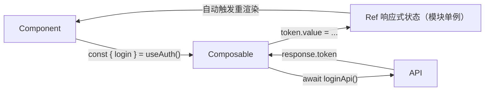

# 状态管理文档模板（tpl-state-composable — Composition API 自管理版）

> 👤 负责角色：**state-agent**（状态管理员）
> 📋 职责：分析状态管理方案（Vuex 或 Composables），梳理状态结构、Actions、Mutations 和数据流
>
> 适用场景：项目未使用 Vuex，通过 `composables/` 目录下的组合函数共享状态；
> 或作为 Vuex 的补充，用于局部跨组件状态共享。

```markdown
# Composition API 状态管理文档

> 方案：Composition API（无 Vuex） | 生成时间：2026-03-05 09:16:18

## Composables 目录总览

```
src/composables/          （或 src/hooks/）
├── useAuth.js            # 登录状态、用户信息
├── usePermission.js      # 权限判断工具
├── useXxxList.js         # xxx 列表数据（含分页、搜索）
└── useDict.js            # 数据字典缓存
```

---

## useAuth — 登录与用户状态

> 源文件：`src/composables/useAuth.js`

### 设计模式

```js
// 模块级单例：在 composable 外部声明响应式状态
// 所有调用 useAuth() 的组件共享同一份数据
import { ref, computed } from 'vue'

const token = ref(localStorage.getItem('token') || '')
const userInfo = ref(null)

export function useAuth() {
  // ...
  return { token, userInfo, isLoggedIn, login, logout }
}
```

### 暴露的状态

| 变量名 | 类型 | 说明 |
|--------|------|------|
| token | Ref\<string\> | 登录 token |
| userInfo | Ref\<UserInfo \| null\> | 用户基本信息 |
| isLoggedIn | ComputedRef\<boolean\> | 计算属性：!!token |
| permissions | Ref\<string[]\> | 权限码列表 |

### 暴露的方法

| 方法名 | 参数 | 返回值 | 说明 |
|--------|------|--------|------|
| login | (username, password) | Promise\<void\> | 登录，成功后设置 token |
| logout | () | Promise\<void\> | 退出，清除所有状态 |
| fetchUserInfo | () | Promise\<void\> | 刷新用户信息 |

### 数据流



### 在组件中使用

```vue
<script>
import { useAuth } from '@/composables/useAuth'

export default {
  setup() {
    const { userInfo, isLoggedIn, logout } = useAuth()
    return { userInfo, isLoggedIn, logout }
  }
}
</script>

<!-- Vue 2 with @vue/composition-api 插件 -->
<template>
  <div v-if="isLoggedIn">{{ userInfo.name }}</div>
</template>
```

---

## useXxxList — 列表数据管理

> 源文件：`src/composables/useXxxList.js`

### 暴露的状态

| 变量名 | 类型 | 初始值 | 说明 |
|--------|------|--------|------|
| list | Ref\<Item[]\> | [] | 列表数据 |
| total | Ref\<number\> | 0 | 总条数 |
| loading | Ref\<boolean\> | false | 加载状态 |
| page | Ref\<number\> | 1 | 当前页码 |
| pageSize | Ref\<number\> | 20 | 每页条数 |
| searchForm | Reactive | {} | 搜索条件 |

### 暴露的方法

| 方法名 | 参数 | 说明 |
|--------|------|------|
| fetchList | () | 用当前参数发起请求 |
| search | () | 重置到第 1 页并请求 |
| reset | () | 清空搜索条件，重置到第 1 页 |
| handlePageChange | (page) | 切换页码 |

### 使用示例

```vue
<script>
import { useXxxList } from '@/composables/useXxxList'

export default {
  setup() {
    const { list, total, loading, searchForm, search, reset, handlePageChange } = useXxxList()
    return { list, total, loading, searchForm, search, reset, handlePageChange }
  }
}
</script>
```

---

## 与 Vuex 对比说明

| 特性 | Vuex | Composition API 自管理 |
|------|------|----------------------|
| 适合场景 | 全局共享、跨多页面 | 局部共享、单页面或相关页面 |
| 调试工具 | Vue DevTools 完整支持 | 基础支持（可看 reactive 数据） |
| 代码组织 | 集中在 store 目录 | 分散在 composables 目录 |
| 模块间通信 | actions/mutations | 直接引用其他 composable |
| 持久化 | 手动写 localStorage | 手动写 localStorage |

## 状态共享范围说明

| 共享方式 | 范围 | 实现 |
|---------|------|------|
| 模块外 ref（单例） | 所有使用该 composable 的组件 | 在 composable 函数外声明 ref |
| 函数内 ref | 仅当前调用实例 | 在 composable 函数内声明 ref |
| provide/inject | 父子树 | 祖先 provide，后代 inject |
```