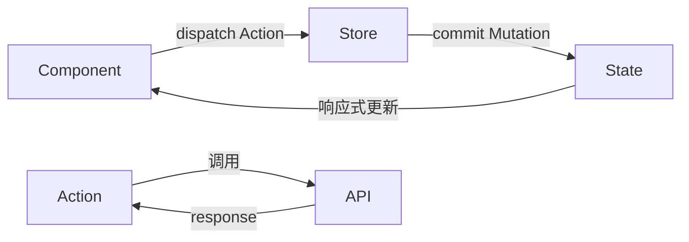

# 状态管理文档模板（tpl-state-vuex — Vuex 版）

> 👤 负责角色：**state-agent**（状态管理员）
> 📋 职责：分析 Vuex Store 结构，梳理 State、Getters、Actions、Mutations 和各 Module 的数据流

```markdown
# Vuex 状态管理文档

> 方案：Vuex 3/4 | 生成时间：2026-03-05 09:16:18

## Store 结构总览

```
src/store/
├── index.js          # Store 入口，注册模块
├── modules/
│   ├── user.js       # 用户模块：登录状态、用户信息
│   ├── permission.js # 权限模块：路由权限、按钮权限
│   └── xxx.js        # 业务模块：xxx 数据
```

---

## [ModuleName] 详细说明

> 源文件：`src/store/modules/xxx.js`

### State

| 字段 | 类型 | 初始值 | 说明 |
|------|------|--------|------|
| token | string | '' | 登录 token |
| userInfo | object \| null | null | 用户信息 |
| permissions | string[] | [] | 权限码列表 |

### Getters

| Getter | 返回值 | 说明 |
|--------|--------|------|
| isLoggedIn | boolean | !!state.token |
| hasPermission | (code) => boolean | 检查是否拥有某权限 |

### Actions

| Action | 参数 | 功能 | 内部调用 |
|--------|------|------|---------|
| login | { username, password } | 登录，成功后设置 token | commit SET_TOKEN |
| logout | — | 退出，清除所有状态 | commit CLEAR_USER |
| fetchUserInfo | — | 获取用户信息 | commit SET_USER_INFO |

### Mutations

| Mutation | 参数 | 功能 |
|----------|------|------|
| SET_TOKEN | token | 设置 token |
| SET_USER_INFO | userInfo | 设置用户信息 |
| CLEAR_USER | — | 清空用户相关状态 |

### 在组件中使用

```vue
<script>
// Vue 2 Options API
import { mapState, mapActions } from 'vuex'

export default {
  computed: {
    ...mapState('user', ['token', 'userInfo']),
    ...mapGetters('user', ['isLoggedIn'])
  },
  methods: {
    ...mapActions('user', ['login', 'logout'])
  }
}
</script>

<!-- Vue 3 Composition API -->
<script setup>
import { useStore } from 'vuex'
const store = useStore()

const token = computed(() => store.state.user.token)
const login = (payload) => store.dispatch('user/login', payload)
</script>
```

---

## 数据流图



## 模块间依赖关系

| 模块 A | 依赖模块 B | 依赖方式 | 说明 |
|--------|-----------|---------|------|
| permission | user | 读取 user.state.userInfo.roles | 根据用户角色计算权限 |

## 持久化策略

| 数据 | 持久化方式 | 存储位置 | 说明 |
|------|-----------|---------|------|
| token | localStorage | `token` | 刷新页面后保持登录 |
| userInfo | 不持久化 | — | 刷新后重新请求 |
```
